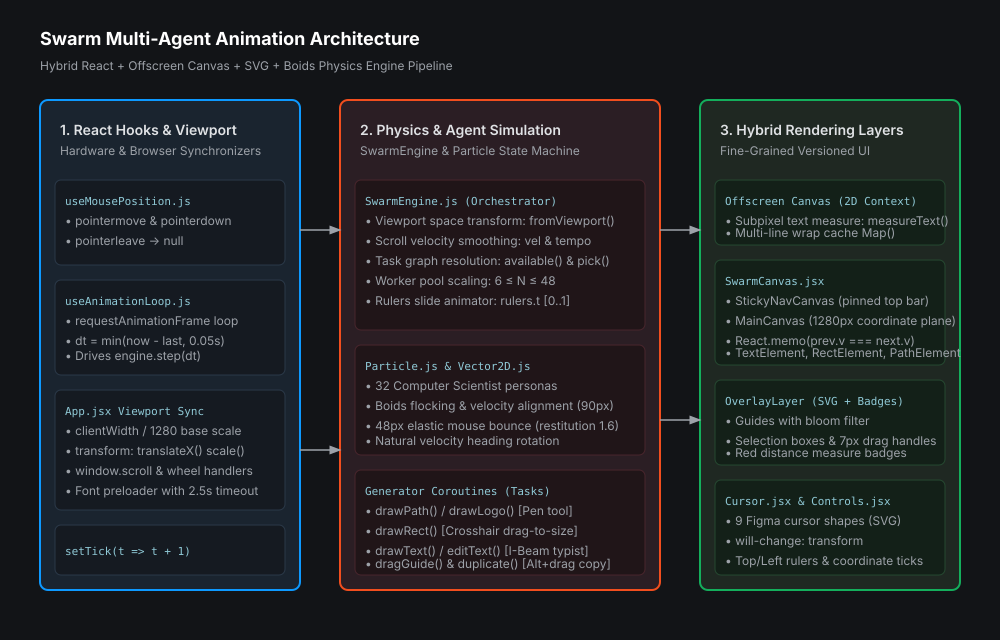
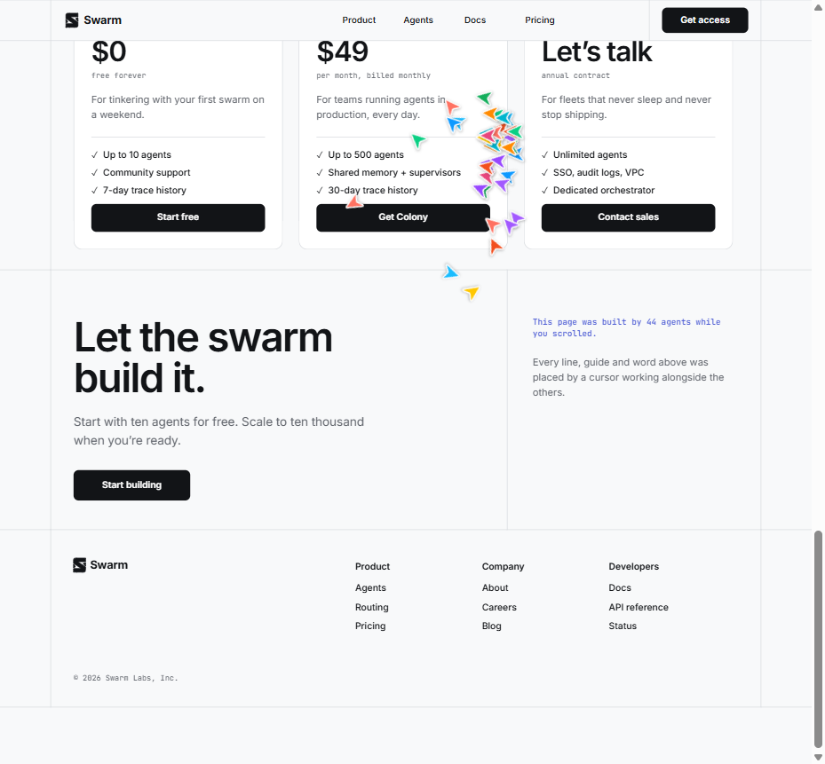

# Swarm Animation Skill

<p align="center">
  
</p>

<p align="center">
  <strong>Bring intelligent swarm animation, natural cursor movement and interactive particle physics into your React projects.</strong>
</p>

<p align="center">
  <a href="https://github.com/badhonvitality/swarm-animation-skill/actions/workflows/ci.yml"></a>
  <a href="LICENSE"></a>
  <a href="https://react.dev"></a>
  <a href="https://skills.sh"></a>
</p>

---

## Overview

**Swarm Animation Skill** is a production-grade AI Agent Skill and React animation framework. It coordinates autonomous agent cursors that exhibit organic flocking behavior, orbit user inputs or autonomous Lissajous trajectories, deflect around the user pointer via elastic physics, and collaboratively draft and typeset documents in real time.

Extracted and reconstructed into a clean, modular architecture, this skill allows AI coding agents and human engineers to integrate high-performance collaborative canvas simulations into any modern React application.

---

## Key Features

- **Autonomous Multi-Agent Cursors**: 9 collaborative Figma-style SVG cursor shapes (`arrow`, `dup`, `pen`, `pen-add`, `pen-close`, `cross`, `ibeam`, `ew`, `ns`), velocity heading rotation, and click-depression scaling.
- **Boids Flocking Physics**: Newtonian orbital mechanics with harmonic radius breathing, alternating tangential swirl, and 90px neighbor velocity alignment.
- **Elastic Collision Repulsion**: 48px boundary around user cursor with velocity momentum reflection, $1.6\times$ restitution coefficient, and $260\text{px/s}$ outward impulse.
- **Hybrid 3-Layer Canvas**: Offscreen Canvas 2D context for sub-pixel text metrics, SVG for vector drafting, and DOM for styled elements.
- **Collaborative Task Engine**: ES6 generator coroutines executing path drawing, rectangle drafting, character-by-character typing with blinking carets, guide dragging, and Option-drag element duplication.
- **60 FPS Hardware Performance**: Decoupled mutable particle integration with granular React version memoization (`v: el.v`), eliminating layout thrashing and unnecessary re-renders.

---

## Visual Reference

<p align="center">
  
</p>
<p align="center"><em>Live simulation preview: multi-agent cursors drafting sections, typing headlines, and measuring component gaps.</em></p>

---

## Installation

### 1. Primary: Skills CLI (For AI Agents & Projects)
The primary distribution method for this skill is the official [Skills CLI](https://skills.sh):

```bash
npx skills add badhonvitality/swarm-animation-skill
```

### 2. Alternative: GitHub Packages (npm Library)
You can also install the React components and physics engine as an npm package via GitHub Packages:

```bash
# Configure npm registry for @badhonvitality scope
npm config set @badhonvitality:registry https://npm.pkg.github.com

# Install package
npm install @badhonvitality/swarm-animation-skill
```

### Supported Skills CLI Options
The Skills CLI supports project-level and global installations across modern AI agent platforms:

```bash
# Install for all configured agents in current project
npx skills add badhonvitality/swarm-animation-skill --all

# Install globally for user-level access
npx skills add badhonvitality/swarm-animation-skill -g

# Install for specific agents (e.g., Claude Code, Cursor)
npx skills add badhonvitality/swarm-animation-skill --agent claude-code cursor

# List available skills in the repository without installing
npx skills add badhonvitality/swarm-animation-skill --list
```

### Supported Agent Environments
- **Google Antigravity IDE** (`.agents/skills/swarm-animation`)
- **Claude Code** (`.claude/skills/swarm-animation`)
- **Cursor IDE** (`.cursor/skills/swarm-animation`)
- **GitHub Copilot / OpenAI Codex**
- **Windsurf Cascade**

### Manual Installation Fallback
If you prefer manual integration without the CLI, copy `skills/swarm-animation/` into your project's `.agents/skills/` directory.

---

## Architecture Overview

Swarm divides rendering into a hybrid 3-layer surface to balance visual sharpness, DOM accessibility, and 60 FPS animation speed:

```
┌────────────────────────────────────────────────────────┐
│ App.jsx (useAnimationLoop + useMousePosition)          │
└───────────────────────────┬────────────────────────────┘
                            │
       ┌────────────────────┼────────────────────┐
       ▼                    ▼                    ▼
[DOM Elements]       [SVG Vector Layer]    [Offscreen Canvas]
• .el-text (Inter)   • .paths (Lines)     • Measure text width
• .el-rect (Cards)   • .overlay (Guides)  • Solve multiline wraps
• Versioned: el.v++  • 9 Cursor Shapes    • Zero DOM reflows
```

For complete technical specifications:
- [Architecture Documentation](docs/architecture.md)
- [Animation Engine Deep Dive](docs/animation-engine.md)
- [Mouse Control Specification](docs/mouse-control.md)
- [Design System & Palette](docs/design-system.md)

---

## Quick-Start React Integration

```jsx
import React, { useEffect, useState } from 'react';
import { CANVAS_WIDTH, SwarmEngine } from './physics/SwarmEngine.js';
import { MainCanvas, StickyNavCanvas, OverlayLayer } from './components/SwarmCanvas.jsx';
import { CursorsLayer } from './components/Cursor.jsx';
import { Rulers, IntroLogo } from './components/Controls.jsx';
import { useMousePosition } from './hooks/useMousePosition.js';
import { useAnimationLoop } from './hooks/useAnimationLoop.js';
import './styles/global.css';

export function SwarmLandingPage() {
  const [engine, setEngine] = useState(null);
  const [, setTick] = useState(0);

  // Initialize engine after preloading fonts
  useEffect(() => {
    const fonts = ['400 16px Inter', '600 16px Inter', '400 16px "JetBrains Mono"'];
    Promise.race([
      Promise.all(fonts.map((f) => document.fonts?.load(f))),
      new Promise((res) => setTimeout(res, 2500)),
    ]).then(() => setEngine(new SwarmEngine()));
  }, []);

  // Track mouse coordinates
  useMousePosition(engine);

  // Responsive scaling & scroll binding
  useEffect(() => {
    if (!engine) return;
    const updateSize = () => {
      const clientW = document.documentElement.clientWidth;
      const s = Math.min(1, clientW / CANVAS_WIDTH);
      engine.vp.vw = clientW;
      engine.vp.vh = window.innerHeight;
      engine.vp.s = s;
      engine.vp.left = (clientW - CANVAS_WIDTH * s) / 2;
    };
    const onScroll = () => engine.setScroll(window.scrollY);
    const onWheel = () => { if (window.scrollY > 0) engine.start(); };

    updateSize();
    window.addEventListener('resize', updateSize);
    window.addEventListener('scroll', onScroll, { passive: true });
    window.addEventListener('wheel', onWheel, { passive: true });

    return () => {
      window.removeEventListener('resize', updateSize);
      window.removeEventListener('scroll', onScroll);
      window.removeEventListener('wheel', onWheel);
    };
  }, [engine]);

  // Main animation step loop (clamped to 50ms)
  useAnimationLoop((dt) => {
    if (!engine) return;
    engine.step(dt);
    setTick((t) => t + 1);
  }, Boolean(engine));

  if (!engine) return null;

  return (
    <>
      <div className="page" style={{ height: engine.height * engine.vp.s }}>
        <StickyNavCanvas engine={engine} />
        <MainCanvas engine={engine} />
        <IntroLogo started={engine.started} />
        <OverlayLayer engine={engine} />
        <CursorsLayer engine={engine} />
      </div>
      <Rulers engine={engine} />
    </>
  );
}
```

---

## Standalone Examples

The skill provides production-ready example files in `skills/swarm-animation/examples/`:
- [`swarm-canvas.example.jsx`](skills/swarm-animation/examples/swarm-canvas.example.jsx): Standalone 3-layer canvas component.
- [`agent-cursor.example.jsx`](skills/swarm-animation/examples/agent-cursor.example.jsx): Agent cursor component with all 9 shapes and heading rotation.
- [`mouse-tracking.example.js`](skills/swarm-animation/examples/mouse-tracking.example.js): Responsive pointer tracking hook supporting touch and mouse.
- [`physics-engine.example.js`](skills/swarm-animation/examples/physics-engine.example.js): Standalone Vector2D class and Boids physics simulation module.

---

## Project Structure

```text
swarm-animation-skill/
├── .agents/                          # Agent discovery directory
│   └── skills/swarm-animation/       # Auto-synced skill copy
├── skills/
│   └── swarm-animation/              # Canonical AI Agent Skill
│       ├── SKILL.md                  # Main skill specification
│       ├── references/               # Technical manuals
│       ├── examples/                 # Reusable code snippets
│       └── assets/                   # Architecture SVG & screenshot
├── docs/                             # System documentation
│   ├── architecture.md
│   ├── animation-engine.md
│   ├── mouse-control.md
│   └── design-system.md
├── src/                              # Reconstructed React application
├── public/                           # Static assets
├── scripts/                          # Sync and CI validation utilities
├── .github/                          # Workflows and community templates
├── CONTRIBUTING.md
├── CODE_OF_CONDUCT.md
├── SECURITY.md
├── LICENSE                           # MIT License
├── NOTICE
└── THIRD_PARTY_NOTICES.md
```

---

## Development & Testing

### Running the Live Application
```bash
npm install
npm run dev
```

### Synchronizing the Skill Copies
```bash
npm run sync-skills
```

### Validating Skill Integrity
```bash
npm run validate
```

### Building for Production
```bash
npm run build
```

---

## Contributing

We welcome contributions! Please review our [Contributing Guidelines](CONTRIBUTING.md) and [Code of Conduct](CODE_OF_CONDUCT.md) before submitting pull requests.

---

## License & Attribution

- **Code & Skill**: Released under the [MIT License](LICENSE) &copy; 2026 badhonvitality.
- **Third-Party Assets**: Inter Font (SIL OFL 1.1), JetBrains Mono (Apache 2.0). See [THIRD_PARTY_NOTICES.md](THIRD_PARTY_NOTICES.md) for full licensing details.
- **Attribution**: See [NOTICE](NOTICE) for project attribution and acknowledgements.
