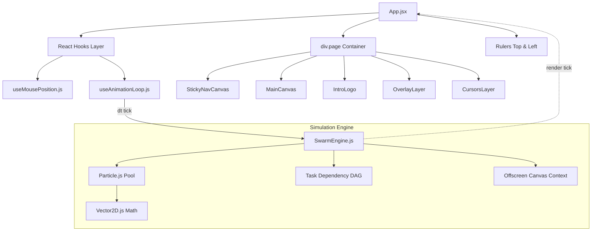

# Swarm Animation: System Architecture

## 1. Executive Overview

**Swarm Animation** is a production-grade multi-agent simulation framework for React. It renders a collaborative canvas populated by autonomous cursor agents that simulate intelligent behavior: orbiting user interactions, dodging pointer gestures, and executing procedural document construction tasks in parallel.

The system is architected around a **decoupled simulation-rendering pattern**, combining mutable numerical integration with fine-grained React reconciliation.

---

## 2. Component Hierarchy & Flow



---

## 3. The 3-Layer Hybrid Rendering Pipeline

Rather than relying purely on an HTML5 `<canvas>` (which loses crisp typography and DOM accessibility) or pure DOM elements (which can suffer severe layout thrashing under hundreds of moving nodes), Swarm uses a hybrid strategy:

| Layer | Rendering Technology | Role & Responsibility |
|---|---|---|
| **Text & Cards** | HTML DOM (`.el-text`, `.el-rect`) | High-resolution native typography with browser subpixel antialiasing, OpenType features (`cv11`, `ss01`), and styled borders. |
| **Vector Geometry** | Scalable Vector Graphics (`.paths`, `.overlay`) | Sharp vector paths, connector lines, logo assembly animations, guide indicators, and measurement lines. |
| **Metrics Engine** | Offscreen HTML5 Canvas 2D | Sub-pixel string width calculation, multiline word wrapping solver, and font metrics cache without causing browser layout reflows. |

---

## 4. Responsive Coordinate System

All element coordinates, task thresholds, and vector paths are authored in a virtual **1280px coordinate space**.

### Responsive Scaling Formula
$$\text{scale} = \min\left(1, \ \frac{\text{clientWidth}}{1280}\right)$$
$$\text{left} = \frac{\text{clientWidth} - 1280 \cdot \text{scale}}{2}$$

The main canvas is transformed via hardware-accelerated CSS:
```css
.canvas {
  position: absolute;
  top: 0;
  left: 0;
  transform: translateX(var(--gutter-left)) scale(var(--scale));
  transform-origin: 0 0;
}
```
This guarantees identical layout behavior and proportional rendering across mobile devices (320px–480px), tablets (768px–1024px), laptops (1280px–1440px), and ultrawide monitors (2560px+).

---

## 5. Performance Optimization: Fine-Grained Versioning

A naive React implementation of 200+ elements updated 60 times per second causes massive CPU bottlenecks. Swarm eliminates this through **Version Memoization**:

1. Elements carry an integer version `v: el.v`.
2. When an agent types a character into element `el`, it bumps `el.v++`.
3. Elements are wrapped in `React.memo` with a strict comparator:
   ```javascript
   export const TextElement = React.memo(
     ({ el, v }) => { ... },
     (prevProps, nextProps) => prevProps.v === nextProps.v
   );
   ```
4. Only the element currently being edited re-renders. All other 200+ elements skip React fiber reconciliation completely.

